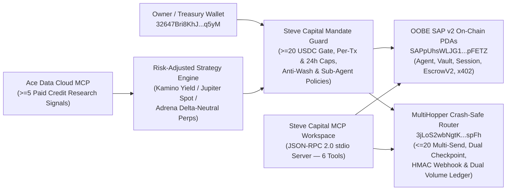

# Steve Capital x OOBE SAP v2 x MultiHopper Autonomous Capital Agent

[](./LICENSE)
[](https://nodejs.org/)
[](https://solana.com/)

Autonomous Solana capital management agent, programmable risk guardrail engine, crash-safe **MultiHopper** routing SDK, **Ace Data Cloud** conviction scorer, and **Model Context Protocol (MCP)** JSON-RPC 2.0 server built for **Steve Capital** (**OOBE Protocol — Synapse Agent Protocol `SAP v2`**).

- **Author**: Ronan Chen Lopes (`@LBCron` / `ronanchenlopes@gmail.com`)
- **Agent / Treasury Wallet (Solana Mainnet)**: `32647Bri8KhJQE11x26iF7fpae9nouCJSZ8Y2VPpq5yM`

---

## Architecture Overview



---

## Verified Solana Mainnet Program Addresses

| Protocol Component | Solana Mainnet Program / PDA | Role |
|---|---|---|
| **OOBE Protocol SAP v2** | `SAPpUhsWLJG1FfkGRcXagEDMrMsWGjbky7AyhGpFETZ` | Canonical Synapse Agent Protocol (`Agent`, `Vault`, `Session`, `Delegate`, `EscrowV2`, `ToolCategory`) |
| **SAP `GlobalRegistry` PDA** | `9odFrYBBZq6UQC6aGyzMPNXWJQn55kMtfigzhLg6S6L5` | Singleton registry (`["sap_global"]`, canonical `bump = 255`) |
| **MultiHopper Core** | `3jLoS2wbNgtKzieUUxwg6Xhdv6gbZkHDtPWA9ZAgspFh` | Non-custodial programmable routing & Multi-Send (`RouteConfig`, `RouteState`, `Vault`) |
| **MultiHopper Orchestrator** | `4TPCmR2uN3hDM1FbTsf7ZtFXwXGSz4u1Kxv5YHj6eruX` | Multi-hop route execution coordinator |
| **MultiHopper Hook Guard** | `2JEv3pD6nczEvn1xDXaEzehkJofPPjoQQpnW5nGY3r52` | Token-2022 transfer hook & TRM Labs compliance screening guard |
| **Mainnet USDC Mint** | `EPjFWdd5AufqSSqeM2qN1xzybapC8G4wEGGkZwyTDt1v` | Primary capital & settlement collateral (6 decimals) |

---

## Core Modules

1. **[`src/solana-pda.mjs`](./src/solana-pda.mjs)** — Zero-dependency Base58 codec, exact `curve25519-dalek` Ed25519 curve residency decompression (`isOnEd25519Curve`), bit-exact `findProgramAddressSync` (verified against all 10 official `@synapse-sap/sdk` `ToolCategory` PDAs and `GlobalRegistry`), and live Solana Mainnet JSON-RPC `verifyMainnetPrograms`.
2. **[`src/sap-mandate-engine.mjs`](./src/sap-mandate-engine.mjs)** — Full SAP v2 account hierarchy derivation (`deriveSapAgentHierarchy`), `SteveMandateGuard` programmable risk controls (`>= 20 USDC` Arena gate, per-tx & rolling 24h USD ceilings, slippage/leverage caps, specialist sub-agent vaults, and anti-wash/circular route blocking), plus Ed25519 `sap-x402-v2` payment header signing and verification.
3. **[`src/multihopper-router.mjs`](./src/multihopper-router.mjs)** — Deterministic MultiHopper Core PDA derivation (`deriveMultiHopperPda`), `<= 20` destination Multi-Send payroll chunker with exact `BigInt` conservation (`chunkPayrollIntoRoutes`), crash-safe 7-step Dual-Checkpoint deployment broadcaster (`executeCrashSafeDeployment` + `0600` append-only `CrashSafeJournal`), constant-time HMAC-SHA256 webhook verification, and `MultiHopperDualLedger` tracking both the **Steve Capital x MultiHopper Side-Track** (single-counted routed principal & completed transfer count) and the **MultiHopper Build & Route Challenge** (`collected_fees / 0.0025`).
4. **[`src/strategy-engine.mjs`](./src/strategy-engine.mjs)** — Volatility-aware portfolio allocator across Kamino USDC lending, Jupiter spot momentum, Adrena delta-neutral perpetual funding capture, and MultiHopper profit sweeps, paired with `AceResearchLedger` (`>= 5` purchased-credit Ace MCP requests tracker).
5. **[`src/mcp-server.mjs`](./src/mcp-server.mjs)** — Standards-compliant **MCP JSON-RPC 2.0** server exposing 6 tools (`sap_derive_agent_pdas`, `steve_evaluate_mandate`, `steve_compute_allocation`, `multihopper_plan_route`, `multihopper_verify_webhook`, `solana_verify_mainnet_programs`) for direct connection in the **Steve Capital MCP Workspace**.

---

## Quickstart & Verification

```bash
# Run the complete 10-suite unit test harness (zero external dependencies required)
npm test

# Run the live Solana Mainnet RPC + SAP v2 + MultiHopper + Ace MCP walkthrough
npm run demo

# Start the JSON-RPC 2.0 stdio MCP server for Steve Capital MCP Workspace
npm run mcp
```

### Connecting to Steve Capital MCP Workspace

Import [`examples/steve-mcp-workspace.json`](./examples/steve-mcp-workspace.json) into your MCP client or Steve Capital agent configuration:

```json
{
  "mcpServers": {
    "steve-capital-multihopper": {
      "command": "node",
      "args": ["./src/mcp-server.mjs"],
      "env": {
        "SOLANA_RPC_URL": "https://api.mainnet-beta.solana.com",
        "STEVE_AGENT_WALLET": "32647Bri8KhJQE11x26iF7fpae9nouCJSZ8Y2VPpq5yM"
      }
    }
  }
}
```
